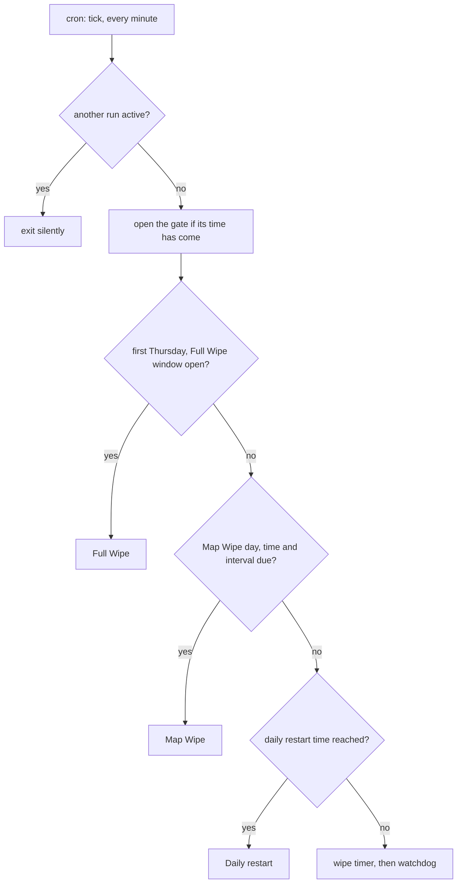
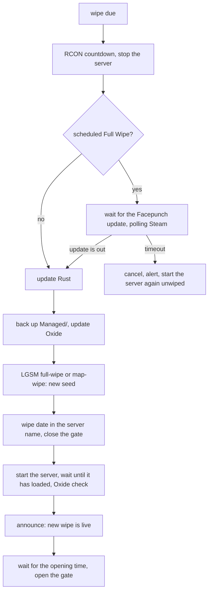
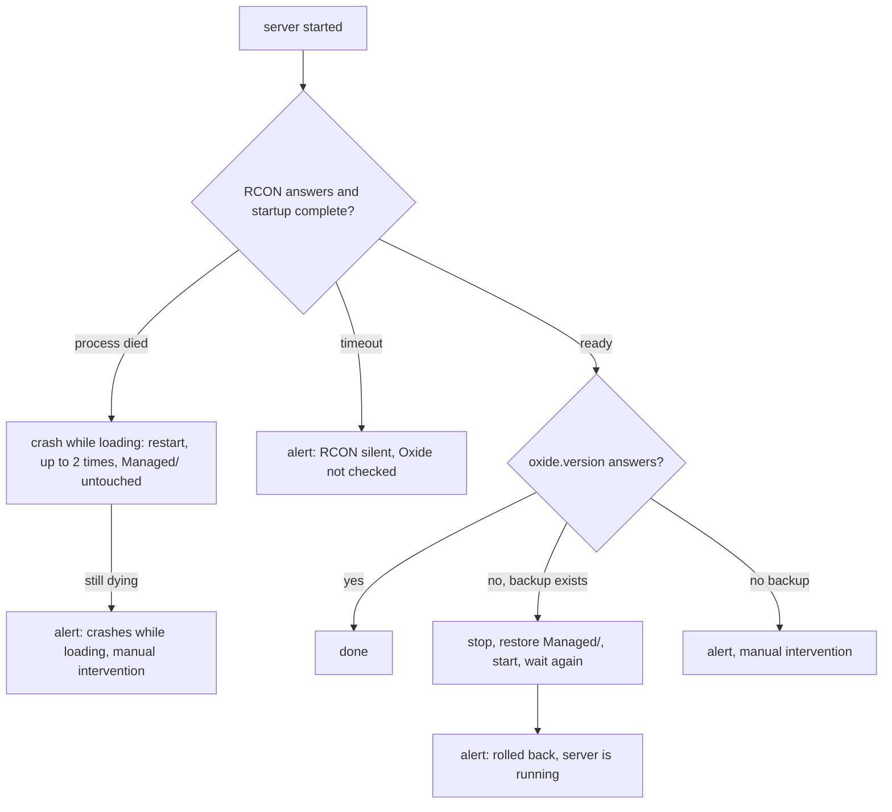
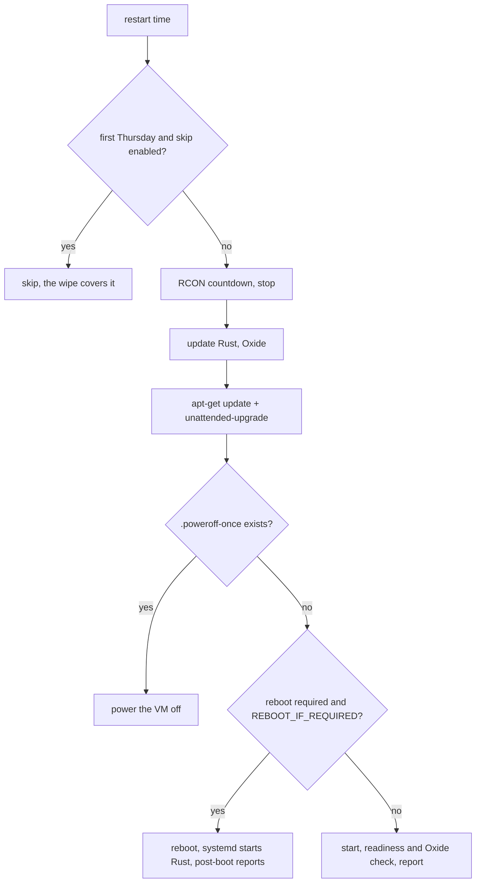
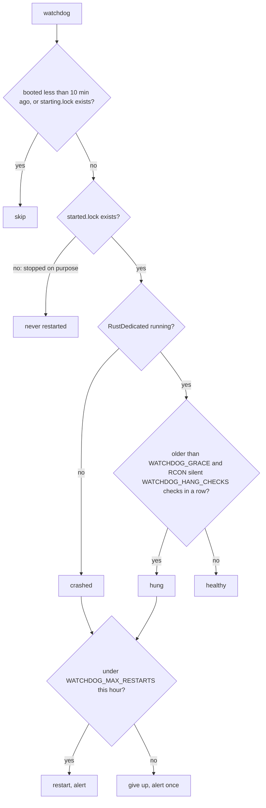

<div align="center">

# Rust Wipe Manager

**Hands-off wipes, restarts and updates for [Rust](https://rust.facepunch.com/) servers running on [LinuxGSM](https://linuxgsm.com/), with Telegram reports.**

[](LICENSE)
[](manager.sh)
[](https://linuxgsm.com/)
[](https://ubuntu.com/)
[](https://github.com/wobujidao/rust-wipe-manager/commits)

**English** | [Русский](README_RU.md)

</div>

Running a Rust server is a calendar of chores. Every day the server needs a restart and updates. On the first Thursday of the month Facepunch ships a forced update at 19:00 London time, and the server has to be down, wiped, updated, loaded and open at the right moment. Oxide may break on the new build. Servers crash and hang at 3 a.m.

Rust Wipe Manager does all of it from a single cron line. You describe the schedule in one config file, the script does the work and reports every step to Telegram, and a built-in watchdog brings the server back when it falls over. It is one Bash script with no dependencies beyond what a LinuxGSM host already has, and it was built on a real production server (Ubuntu 24.04, Proxmox VM, LinuxGSM, uMod/Oxide).

## Contents

- [Features](#features)
- [Quick start](#quick-start)
- [Requirements](#requirements)
- [Installation](#installation)
- [Configuration reference](#configuration-reference)
- [Commands](#commands)
- [How it works](#how-it-works)
- [Telegram messages](#telegram-messages)
- [Troubleshooting](#troubleshooting)
- [Contributing](#contributing)
- [License](#license)

## Features

**Scheduling**
- One cron line, `manager.sh tick` every minute, runs the whole schedule from `config.env`. Change times and intervals without touching cron.
- **Daily restart** with an RCON countdown for players, Rust and Oxide updates and OS updates while the server is down.
- **Full Wipe** on the first Thursday of the month: starts before the Facepunch update, waits for the update to actually appear in Steam, then wipes map and blueprints.
- **Map Wipes** between the forced wipes, on a weekday of your choice, every N weeks, optionally only on chosen days of the month. Blueprints are kept.
- Every event fires once a day inside a window; a machine that was off at that time skips it instead of running it hours late.

**After a wipe**
- **Opening gate**: the server comes up with `maxplayers 0`, so players wait in Rust's own queue, and opens at a fixed time or at the next N-minute mark once it has loaded.
- **Server name with the wipe date** (`My Rust Server | WIPE 06.11`) and the **real next-wipe time in the server browser**.
- "New wipe is live" is announced only when the server has really finished loading (RCON answers *and* `Server startup complete` is in the console log).

**Safety nets**
- **Oxide check** after every start, with a rollback of `Managed/` to the copy made before the Oxide update. A game crash during loading is retried and never mistaken for an Oxide failure.
- **Watchdog**: restarts a crashed or hung server, gives up after too many restarts per hour, and never touches a server you stopped on purpose.
- **OS maintenance** in the restart window: `unattended-upgrade`, reboot if the OS asks for it, a post-boot report, and a one-time power-off flag for host maintenance.
- One run at a time (`flock`), secrets kept apart from the config.

**Telegram**
- Three verbosity levels, messages in English or Russian, plain text that survives `+` and `_`.

## Quick start

For a host that already runs a LinuxGSM Rust server managed by systemd (see [Installation](#installation) if it does not yet):

```bash
git clone https://github.com/wobujidao/rust-wipe-manager.git ~/rust_server
cd ~/rust_server && mkdir -p logs
cp config.env.example config.env
cp secrets.env.example .secrets.env && chmod 600 .secrets.env
nano config.env .secrets.env        # paths, server name, schedule, bot token, RCON password

./manager.sh test-telegram          # a message must arrive
./manager.sh check-update           # prints "UPDATE AVAILABLE" or "No update" (exit code 2: builds unreadable)

crontab -e                          # add the two lines below
```

```cron
* * * * * /home/YOUR_USERNAME/rust_server/manager.sh tick >> /home/YOUR_USERNAME/rust_server/logs/cron.log 2>&1
@reboot   /home/YOUR_USERNAME/rust_server/manager.sh post-boot >> /home/YOUR_USERNAME/rust_server/logs/cron.log 2>&1
```

That is all: the schedule now lives in `config.env`. Map Wipes and the opening gate are off by default; see [Configuration reference](#configuration-reference).

## Requirements

- Linux with **systemd** and **cron**; developed and used on Ubuntu 24.04 LTS (Debian-based distributions should work).
- A working **LinuxGSM** `rustserver` with **Oxide/uMod** installed; the script drives it through LGSM commands.
- [**rcon-cli**](https://github.com/gorcon/rcon-cli) by gorcon (the script uses WebRCON, which LGSM enables by default).
- Standard tools: `bash`, `curl`, `flock`, `pgrep`, `awk`, `sed`, GNU `date`/`find`/`stat`.
- A **Telegram bot** (optional but recommended): create one with [@BotFather](https://t.me/BotFather).
- `sudo` rights for the server user, limited to a short list of commands (step 4 below).

## Installation

### 1. LinuxGSM, the Rust server and Oxide

```bash
curl -Lo linuxgsm.sh https://linuxgsm.sh && chmod +x linuxgsm.sh && bash linuxgsm.sh rustserver
./rustserver auto-install
./rustserver mods-install        # choose Oxide
```

In `lgsm/config-lgsm/rustserver/rustserver.cfg` keep `seed=""` (LGSM then picks a new random seed on every wipe) and a `maxplayers="N"` line (the opening gate needs it).

### 2. rcon-cli

```bash
cd ~
wget https://github.com/gorcon/rcon-cli/releases/download/v0.10.3/rcon-0.10.3-amd64_linux.tar.gz
tar -xzf rcon-0.10.3-amd64_linux.tar.gz && rm rcon-0.10.3-amd64_linux.tar.gz
```

### 3. systemd unit

Copy [`rustserver.service`](rustserver.service) to `/etc/systemd/system/`, replace `YOUR_USERNAME`, then:

```bash
sudo systemctl daemon-reload
sudo systemctl enable --now rustserver
```

> **Why `Type=oneshot` and not `forking`?** LinuxGSM runs the server inside tmux and detaches it, so with `forking` systemd loses track of the real process. `oneshot` with `RemainAfterExit=yes` works reliably with LGSM.

### 4. sudoers

The script needs passwordless `sudo` for exactly these commands:

```bash
echo 'YOUR_USERNAME ALL=(root) NOPASSWD: /usr/bin/systemctl start rustserver, /usr/bin/systemctl stop rustserver, /usr/bin/apt-get update -qq, /usr/bin/unattended-upgrade, /usr/sbin/reboot, /usr/sbin/poweroff' | sudo tee /etc/sudoers.d/YOUR_USERNAME-rustserver
sudo chmod 440 /etc/sudoers.d/YOUR_USERNAME-rustserver
sudo visudo -cf /etc/sudoers.d/YOUR_USERNAME-rustserver
```

If you use `SYSTEM_UPDATE_ENABLED`, also stop Ubuntu from upgrading at a random time of day, so updates land only while the server is down. In `/etc/apt/apt.conf.d/20auto-upgrades`:

```
APT::Periodic::Update-Package-Lists "1";
APT::Periodic::Unattended-Upgrade "0";
```

### 5. The manager

```bash
git clone https://github.com/wobujidao/rust-wipe-manager.git ~/rust_server
cd ~/rust_server
mkdir -p logs                     # cron opens cron.log before the script can create the folder
cp config.env.example config.env
cp secrets.env.example .secrets.env
chmod 600 .secrets.env
```

`config.env`, `.secrets.env`, `logs/` and `.state/` are in `.gitignore`, so `git pull` updates the script without touching your settings.

### 6. Configure

- `.secrets.env`: `TELEGRAM_BOT_TOKEN` (from @BotFather), `TELEGRAM_CHAT_ID` (from @userinfobot; negative for groups) and `RCON_PASS` (the `rconpassword` in `lgsm/config-lgsm/rustserver/secrets-rustserver.cfg`).
- `config.env`: paths, server name and the schedule. Every setting is commented in [`config.env.example`](config.env.example) and listed in the [reference](#configuration-reference).

### 7. Test

```bash
~/rust_server/manager.sh test-telegram    # a message arrives in Telegram
~/rust_server/manager.sh check-update     # prints UPDATE AVAILABLE or No update
```

Also run the second command in cron's environment, see [Troubleshooting](#steamcmd-is-downloaded-again-or-update-fails-only-from-cron).

### 8. Cron

```bash
crontab -e
```

```cron
* * * * * /home/YOUR_USERNAME/rust_server/manager.sh tick >> /home/YOUR_USERNAME/rust_server/logs/cron.log 2>&1
@reboot   /home/YOUR_USERNAME/rust_server/manager.sh post-boot >> /home/YOUR_USERNAME/rust_server/logs/cron.log 2>&1
```

`tick` reads `config.env` every minute and runs whatever is due; when nothing is, it runs the watchdog. `post-boot` reports to Telegram whether the server came up after any VM boot, including the reboots the manager triggers itself. All times are the **VM's local time** (`timedatectl`).

### Upgrading from older versions

Older versions used one cron line per job (`manager.sh restart` at 04:30 and `manager.sh fullwipe` on Thursdays). Remove them and add the `tick` line, otherwise two runs start together and the lock cancels one with a Telegram alert. An older `config.env` keeps working: settings added later fall back to built-in defaults, so copy the ones you want from `config.env.example`. If it still has `OXIDE_LOAD_TIMEOUT=300`, raise it to `900` so it covers map generation after a wipe. The old commands `restart` and `fullwipe` still exist.

## Configuration reference

Settings live in `config.env` (the script exits if it or `.secrets.env` is missing). Booleans are `"true"` / `"false"`; durations are in seconds unless the name says otherwise; times are `HH:MM` in the VM's local time.

The **Default** column is what the script assumes when a line is absent from `config.env`. A dagger (†) marks settings that have no built-in fallback: keep the line in `config.env`; the value shown is the one in `config.env.example`.

### Paths and RCON

| Variable | Default | Meaning |
|---|---|---|
| `LGSM_SCRIPT` | † `/home/YOUR_USERNAME/rustserver` | The LinuxGSM script of the server. |
| `LGSM_SELFNAME` | file name of `LGSM_SCRIPT` | LGSM instance name (`rustserver`); names its config, seed, console log and lock files and the server identity folder. Set only for a non-standard layout. |
| `LGSM_LOCK_DIR` | `lgsm/lock` next to `LGSM_SCRIPT` | Where LGSM keeps `<name>-started.lock` and `<name>-starting.lock`. The watchdog reads them. |
| `SERVERFILES_DIR` | † `/home/YOUR_USERNAME/serverfiles` | LGSM `serverfiles` (holds `RustDedicated_Data/`). |
| `RCON_CLI` | † `/home/YOUR_USERNAME/rcon-0.10.3-amd64_linux/rcon` | Path to the rcon-cli binary. |
| `RCON_HOST` | † `127.0.0.1` | Where RCON listens; the script runs on the same machine. |
| `RCON_PORT` | † `28016` | `rconport` from `rustserver.cfg` (game port + 1 by default). |

### Secrets (`.secrets.env`, `chmod 600`)

| Variable | Meaning |
|---|---|
| `TELEGRAM_BOT_TOKEN` | Bot token from @BotFather. |
| `TELEGRAM_CHAT_ID` | Chat or group that receives the messages. |
| `RCON_PASS` | RCON password (`secrets-rustserver.cfg` in LGSM). |

### Telegram and names

| Variable | Default | Meaning |
|---|---|---|
| `ENABLE_TELEGRAM` | † `true` | `false` = log file only. |
| `TELEGRAM_LOG_LEVEL` | † `full` | `full` every step; `success_error` final results and errors; `error_only` errors only. An unknown value behaves as `full`. |
| `MESSAGES_LANG` | `en` | Language of Telegram messages: `en` or `ru`. The log file is always English. |
| `SERVER_NAME` | † `My Rust Server` | Full name, used in the big messages (restart started, new wipe live). |
| `SERVER_TAG` | † `MYSERVER` | Short prefix of every other message. |

### Daily restart

| Variable | Default | Meaning |
|---|---|---|
| `DAILY_RESTART_ENABLED` | † `true` | Run the daily restart (also gates the manual `restart`). |
| `DAILY_RESTART_TIME` | `04:30` | When the countdown starts; the server stops `DAILY_RESTART_COUNTDOWN` later. |
| `DAILY_RESTART_COUNTDOWN` | † `1800` | Countdown shown to players. |
| `DAILY_RESTART_UPDATE_RUST` | † `true` | Update Rust (`lgsm update`) while down. |
| `DAILY_RESTART_UPDATE_OXIDE` | † `true` | Update Oxide (`lgsm mods-update`) while down. A wipe always updates both. |
| `SKIP_DAILY_RESTART_ON_FULLWIPE_DAY` | † `true` | Skip the restart on the first Thursday (the evening wipe restarts and updates anyway). Applies only while `FULLWIPE_ENABLED` is `true`. |

### Full Wipe

First Thursday of the month; the day is fixed because Facepunch's forced update comes that day.

| Variable | Default | Meaning |
|---|---|---|
| `FULLWIPE_ENABLED` | † `true` | Run the scheduled Full Wipe (and the legacy `fullwipe` entry). `false` does not block the manual `fullwipe-now`. |
| `FULLWIPE_LONDON_HOUR` | † `19` | Hour (London time) of Facepunch's update; converted to local time by the script. |
| `FULLWIPE_PRE_WAIT_MINUTES` | † `30` | The countdown starts this long before that hour, so the server is already down when the update lands. The 3-hour window opens then. |
| `FULLWIPE_COUNTDOWN` | † `600` | Countdown before the server stops, for **every** wipe (Full and Map). |
| `FULLWIPE_UPDATE_WAIT_MAX` | † `7200` | How long the scheduled Full Wipe waits for the update. On timeout the wipe is cancelled, an alert is sent and the server is started again, unwiped. |
| `FULLWIPE_UPDATE_CHECK_INTERVAL` | † `120` | How often Steam is asked. |
| `FULLWIPE_OPEN_TIME` | `""` | Opening time after the wipe, see [Opening gate](#opening-gate). |

### Map Wipe

Map only, blueprints kept. Off by default.

| Variable | Default | Meaning |
|---|---|---|
| `MAPWIPE_ENABLED` | `false` | Run Map Wipes. |
| `MAPWIPE_DAY` | `5` | Weekday, 1=Mon … 7=Sun. Not on the Full Wipe day (while `FULLWIPE_ENABLED` is `true`). |
| `MAPWIPE_TIME` | `19:00` | When the countdown starts; the wipe follows `FULLWIPE_COUNTDOWN` later. Window: 1 hour. |
| `MAPWIPE_INTERVAL_WEEKS` | `1` | Every N weeks, counted from the **last wipe of any kind** (age of the newest `*.map` file), so the forced Thursday wipe restarts the count. A scheduled map wipe is skipped only when the map is younger than `7·N − 5` days (2 days for weekly, 9 for bi-weekly): the Friday right after a Thursday wipe is skipped, a 6-day-old map is not. |
| `MAPWIPE_MONTH_DAYS` | `""` | Only on these days of the month, `FROM-TO` (`16-22`) or a single day; empty = any. |
| `MAPWIPE_OPEN_TIME` | `""` | Opening time after the wipe, see [Opening gate](#opening-gate). |

```env
# every Friday at 19:00
MAPWIPE_ENABLED="true"  MAPWIPE_DAY=5  MAPWIPE_TIME="19:00"  MAPWIPE_INTERVAL_WEEKS=1

# every two weeks on Monday at 18:00
MAPWIPE_ENABLED="true"  MAPWIPE_DAY=1  MAPWIPE_TIME="18:00"  MAPWIPE_INTERVAL_WEEKS=2

# exactly twice a month: the forced first-Thursday wipe + the Friday two weeks later (16th-22nd)
MAPWIPE_ENABLED="true"  MAPWIPE_DAY=5  MAPWIPE_TIME="19:50"  MAPWIPE_MONTH_DAYS="16-22"

# every Thursday, players let in at 20:00 (the first Thursday is the Full Wipe instead)
MAPWIPE_ENABLED="true"  MAPWIPE_DAY=4  MAPWIPE_TIME="18:45"  MAPWIPE_OPEN_TIME="20:00"
```

A plain two-week interval would add a third wipe in five-week months, a week before the forced one; `MAPWIPE_MONTH_DAYS` avoids that.

### Server presentation

| Variable | Default | Meaning |
|---|---|---|
| `WIPETIMER_ENABLED` | `false` | Show the real next wipe in the server browser through `wipetimer.wipeunixtimestampoverride`. Applied by `tick` once the server has been up 15 min, and again after every start. A Full Wipe shows the Facepunch update time; a Map Wipe shows `MAPWIPE_OPEN_TIME`, or, when that is empty or `+N`, the moment the server goes down (`MAPWIPE_TIME` + `FULLWIPE_COUNTDOWN`, plus N minutes for `+N`). |
| `SERVERNAME_BASE` | `""` | Base name; with the next setting the LGSM `servername` becomes `BASE \| WIPE dd.mm` on every wipe. Needs a `servername="..."` line in `rustserver.cfg`; `"`, `$` and backticks are refused (LGSM sources that file). |
| `SERVERNAME_WIPE_DATE` | `false` | Enable the dated name. |

### Oxide and server start

| Variable | Default | Meaning |
|---|---|---|
| `OXIDE_BACKUP_BEFORE_UPDATE` | † `true` | Copy `RustDedicated_Data/Managed` to `Managed.backup-<date>` before an Oxide update (copies older than 30 days are deleted). Needed for the rollback. |
| `OXIDE_CHECK_ENABLED` | `true` | After a start, verify `oxide.version`; roll `Managed/` back if Oxide is missing. The wait for the server to load happens even when this is `false`. |
| `OXIDE_LOAD_TIMEOUT` | `900` | How long to wait for the server to finish loading after a start. Must cover map generation after a wipe (10+ minutes on slow hardware). |
| `SERVER_START_TIMEOUT` | † `600` | How long to wait for the `RustDedicated` process to appear (also used by `post-boot`). |

### OS maintenance

| Variable | Default | Meaning |
|---|---|---|
| `SYSTEM_UPDATE_ENABLED` | `false` (`true` in the example) | Run `apt-get update` and `unattended-upgrade` while the server is down. *What* gets installed is Ubuntu's own setting (`Unattended-Upgrade::Allowed-Origins`). |
| `REBOOT_IF_REQUIRED` | `false` (`true` in the example) | If `/var/run/reboot-required` exists, reboot the VM instead of starting the server; systemd starts Rust on boot. |

The one-time power-off flag has no setting: `touch ~/rust_server/.poweroff-once`.

### Watchdog

| Variable | Default | Meaning |
|---|---|---|
| `WATCHDOG_ENABLED` | `true` | Restart a crashed or hung server. |
| `WATCHDOG_GRACE` | `1800` | A process younger than this is never called hung (map generation takes long). |
| `WATCHDOG_HANG_CHECKS` | `5` | RCON silent this many checks in a row (one per minute) = hung. |
| `WATCHDOG_MAX_RESTARTS` | `3` | Per hour. Beyond that the watchdog stops and alerts once. |

### Logs

| Variable | Default | Meaning |
|---|---|---|
| `LOG_DIR` | † `/home/YOUR_USERNAME/rust_server/logs` | Where `manager-YYYYMMDD.log` and `cron.log` go. |
| `LOG_KEEP_DAYS` | `30` | Delete `manager-*.log` older than this. `cron.log` is rotated to `cron.log.1` at 10 MB. |

## Commands

```bash
./manager.sh <command>
```

| Command | What it does |
|---|---|
| `tick` | The cron entry (every minute). Opens a due gate, then runs whatever `config.env` schedules now (Full Wipe, Map Wipe, daily restart), otherwise sets the wipe timer and runs the watchdog. |
| `post-boot` | The `@reboot` entry. Waits for the server process after a boot and reports it (with the kernel version). |
| `restart` | Daily restart right now. Obeys `DAILY_RESTART_ENABLED` and the Full Wipe day skip. |
| `fullwipe-now` | Full Wipe right now: no date check, no wait for the Facepunch update (updates if a build is out, wipes either way). Works even with `FULLWIPE_ENABLED="false"`. Use with caution. |
| `mapwipe-now` | Map Wipe right now: map only, blueprints kept, no date check, no update wait. |
| `watchdog` | One watchdog check (`tick` already does this every minute). |
| `check-update` | Compares the local and remote Rust build. Exit code 0 and `UPDATE AVAILABLE`; 1 and `No update`; 2 and `Cannot read the build numbers (see the log)`. |
| `test-telegram` | Sends a test message. |
| `fullwipe` | Legacy cron entry from before `tick`: Full Wipe only on the first Thursday. |

Only one run at a time is allowed. A second manual run is cancelled with a Telegram alert; `tick` and `watchdog` exit silently when busy.

**One-time power-off** for host-side maintenance: `touch ~/rust_server/.poweroff-once`. At the next daily restart the VM powers off instead of starting the server. The flag is deleted when used, and the host has to start the VM again.

Files next to the script:

```
rust_server/
├── manager.sh          the script
├── config.env          your settings
├── .secrets.env        token, chat id, RCON password (chmod 600)
├── .manager.lock       flock: one run at a time
├── .poweroff-once      optional one-time power-off flag
├── .state/             done-* stamps, gate, hang, restarts, gave_up, wipetimer
└── logs/               manager-YYYYMMDD.log, cron.log (+ cron.log.1)
```

## How it works

### Scheduler

`tick` re-reads `config.env` on every run and picks the first thing that is due.



- **Full Wipe**: first Thursday, from `FULLWIPE_LONDON_HOUR` (London) minus `FULLWIPE_PRE_WAIT_MINUTES`, for 3 hours. Converted to local time, DST included.
- **Map Wipe**: `MAPWIPE_DAY` at `MAPWIPE_TIME`, for 1 hour, if `MAPWIPE_MONTH_DAYS` allows the date and the last wipe of any kind is old enough. Not on the Full Wipe day.
- **Daily restart**: `DAILY_RESTART_TIME`, for 1 hour.
- **Once a day**: a stamp in `.state/done-<event>-<date>` is written when an event starts, so it never repeats the same day. Windows exist so that a VM that was off does not run an event hours late.
- While a wipe or restart runs it holds the lock, so `tick` stays quiet and the watchdog does not interfere.

### Wipe

The same sequence serves the scheduled Full Wipe, Map Wipes and the `*-now` commands.



Only the scheduled Full Wipe waits for Facepunch. Map Wipes and the `*-now` commands run `update` (a no-op when no new build is out) and wipe either way. If the wait times out or the Rust update fails, the wipe is cancelled before anything is wiped: an alert goes out, and the server is started again as it was, Oxide-checked, so players are not locked out until someone reacts (a second alert, "cancelled, server started again without a wipe", confirms it). Run the wipe by hand when you can.

Seed: LinuxGSM, not the manager, changes it. With `seed=""` its `full-wipe` and `map-wipe` write a new random seed, shown in the "new wipe is live" message. A forced Facepunch update alone wipes the map but keeps the same seed, so the terrain repeats; only an LGSM wipe changes it. LGSM wipes only when a `.map`/`.sav` file exists, otherwise it reports "Wipe not required".

### Opening gate

Players who connect at the first second of a wipe overload a half-loaded server. With `MAPWIPE_OPEN_TIME` / `FULLWIPE_OPEN_TIME` set, the manager starts the new map with `maxplayers 0` in the LGSM config, so everyone waits in Rust's own queue ("position N"). At the opening time the original value is restored in the config and over RCON (`server.maxplayers`, read back to confirm) and the queue joins in arrival order.

- `"HH:MM"` opens at a fixed time today. Start the wipe early enough for the map to be generated (about 12 minutes for size 3500). If the time has already passed when the wipe finishes, the server simply opens as soon as it is up.
- `"+N"` opens at the next N-minute mark after the server has *loaded* (`+5`: up at 22:13, opens 22:15), so nobody queues longer than N minutes. Made for the Full Wipe, whose start depends on Facepunch.
- The state is in `.state/gate` (`<open time> <maxplayers>`). If the run dies, the next `tick` reopens the server once the time has come, the process is running and `Server startup complete` has been seen. A dead or half-loaded server is never "opened"; the gate stays closed and the next tick retries.
- Without a `maxplayers="N"` line in the LGSM config the gate is not closed (the log says so).

### Readiness and the Oxide check

After every start the manager waits for **readiness**: RCON answers `serverinfo` *and* the console log of the current start (`log/console/<name>-console.log`) contains `Server startup complete`. RCON alone is not enough: it answers while the world is still loading. The wait is wall-clock and ends after `OXIDE_LOAD_TIMEOUT`. Fallbacks, so a missing or reworded line never blocks anything for good: if there is no console log, or it is older than the running process (console logging off), RCON alone decides; a process older than `OXIDE_LOAD_TIMEOUT` passes even without the line (logged).



- The rollback uses the `Managed.backup-<date>` copy made right before **this run's** Oxide update. If the run did not update Oxide there is nothing to restore, and you get an alert instead.
- If Rust itself was updated in the same run, that copy has no Oxide: the server runs without plugins until uMod ships a fix. Oxide often lags a new Rust build by 30-90 minutes.
- A game crash during loading is not an Oxide failure (a depot caught mid-publish is a typical cause). The manager restarts the server up to twice and leaves `Managed/` alone; a rollback happens only when the server answers RCON without Oxide.
- A wipe is announced, and the gate opened, only for a server that is running and loaded. Otherwise the gate stays closed, `tick` opens it later, and no "live" message is sent.

### Daily restart and OS maintenance



Graceful stop sends `restart <countdown>` over RCON, waits for the countdown, then gives the server 3 minutes to exit before a forced `systemctl stop`.

### Watchdog

Runs from `tick` every minute (or from its own cron entry, in which case a "check" is one cron run).



LinuxGSM removes `lgsm/lock/<name>-started.lock` on a clean stop (`./rustserver stop`, `systemctl stop rustserver`), so a server you stopped yourself stays down. A console or RCON `quit` leaves the lock and counts as a crash. When the server is healthy again, `.state/gave_up` is cleared. The watchdog restarts the server only; it does not run the Oxide check.

### Logs and housekeeping

`logs/manager-YYYYMMDD.log` has every step in English; old files go after `LOG_KEEP_DAYS`. `cron.log` is rotated at 10 MB. LGSM and rcon-cli run with file descriptor 9 closed, so the lock dies with the manager and never leaks into tmux. The script `cd`s into its own directory first, because LGSM's `find` calls fail when the inherited working directory is unreadable.

## Telegram messages

Messages are plain text, prefixed with `SERVER_TAG` (the big ones use `SERVER_NAME`) and sent in `MESSAGES_LANG`. The level decides what is sent: `full` sends all three groups, `success_error` the last two, `error_only` the last one.

**`full`: progress**

| Message | When |
|---|---|
| Daily restart started (countdown N min) | restart begins |
| Skipping daily restart, today is Full Wipe day | first Thursday |
| RCON sent (countdown, reason) · Server stopped · Force stop · Server already stopped | stop sequence |
| Rust updated · Oxide updated · OS updates installed | each update finished |
| OS update needs a reboot · VM powering off for host maintenance | reboot or `.poweroff-once` |
| Waiting for Rust update from Facepunch · Rust update detected after N min | Full Wipe |
| Full Wipe / Map Wipe today, preparation in N min | only the legacy `fullwipe` entry, started early |
| Wipe preparation started · Performing wipe · Wipe completed | wipe steps |
| Server ready, players wait in the queue until HH:MM | gate closed |
| Telegram notification test | `test-telegram` |

**`success`: final results**

| Message | When |
|---|---|
| Daily restart completed successfully | server loaded and the Oxide check passed |
| NEW WIPE IS LIVE! (with the seed) | server loaded after a wipe |
| Server open, the queue is joining (N slots) | gate opened |
| VM booted, server is up (kernel) | `post-boot` |
| Server restarted by the watchdog | watchdog |

**`error`: always sent except with Telegram off**

| Message | Meaning |
|---|---|
| RCON send error · Server did not start in N min | stop or start failed |
| Rust / Oxide / OS update error | an update step failed |
| TIMEOUT: Rust update did not appear in N min | Full Wipe cancelled before wiping |
| Rust update failed, aborting the wipe · Wipe error | wipe aborted |
| Wipe cancelled, server started again without a wipe | after either of the two cancellations above: the server is back, unwiped |
| Server started, but RCON has not answered for N min | readiness timeout, Oxide not checked |
| Oxide did not load, rolling back · Rolled back, server is running · Rollback did not help · no Managed/ backup | Oxide check |
| Server crashed, restarting · Server hung · Watchdog could not start the server | watchdog and crash while loading |
| Server keeps crashing, watchdog stopped | too many watchdog restarts per hour |
| Server crashes while loading (3 starts in a row) | the load-crash retries are used up; `Managed/` untouched |
| VM booted, but the server did not start | `post-boot` |
| manager.sh is already running, second run cancelled | lock held |

## Troubleshooting

All times in logs are the VM's local time. Start with `logs/manager-YYYYMMDD.log` and `logs/cron.log`.

### SteamCMD is downloaded again, or `update` fails only from cron

**Symptom:** `./rustserver update` works in your shell, but a cron run shows LinuxGSM downloading SteamCMD or the update fails; `check-update` exits with code 2 and the log shows `Cannot get versions (Local= Remote=)`.

**Cause:** Ubuntu's `steamcmd` package installs to `/usr/games`. That directory is in your login shell's `PATH` but not in cron's (`/usr/bin:/bin`) or systemd's, so LinuxGSM does not find it and tries to fetch SteamCMD itself during `update` and `start`.

**Fix:** point LinuxGSM at the installed copy:

```bash
mkdir -p ~/.steam
ln -s ~/.local/share/Steam/steamcmd ~/.steam/steamcmd
```

Alternatively add `PATH=/usr/games:/usr/bin:/bin` as the first line of the crontab.

**Test in cron's exact environment:**

```bash
env -i HOME=$HOME PATH=/usr/bin:/bin ~/rust_server/manager.sh check-update
```

It must print `UPDATE AVAILABLE` or `No update` with real build numbers in the log, not `Cannot read the build numbers` (exit code 2). Use the same trick for anything that behaves differently under cron.

### The server does not start after a reboot

```bash
sudo systemctl status rustserver
sudo systemctl is-enabled rustserver
journalctl -u rustserver -n 50
```

The unit must be `enabled` and `Type=oneshot`. The `post-boot` Telegram message tells you whether the process appeared within `SERVER_START_TIMEOUT`.

### `sudo: a password is required` in the log

The sudoers rule is missing or does not match. `sudo -n -l` must list `systemctl start/stop rustserver`, `apt-get update -qq`, `unattended-upgrade`, `reboot` and `poweroff`; a missing OS-maintenance command shows up as an "OS update error" alert.

### `find: Failed to restore initial working directory`

LGSM's `find` fails when the inherited working directory is unreadable, typically after `sudo -u YOUR_USERNAME` from another user's home. `manager.sh` already `cd`s into its own folder. For manual LGSM commands use `sudo -iu YOUR_USERNAME`.

### The daily restart or wipe did not run

Events fire once a day inside a window (1 h for the restart and Map Wipe, 3 h for the Full Wipe); a VM that was off then skips them. Also check that the `tick` line is in `crontab -l`, that times are meant in the VM's timezone (`timedatectl`), and for Map Wipes that `MAPWIPE_INTERVAL_WEEKS` and `MAPWIPE_MONTH_DAYS` allow today (the log says `Map wipe day, but the last wipe was N days ago ... skipping`). The Full Wipe window is built on the VM's local date, so a VM far east of London, where 19:00 London falls after local midnight, is not supported.

### The Full Wipe ran on the old version

The scheduled run waits for the update, so this points to `fullwipe-now` (it does not wait) or to wrong build numbers. Check the wait phase in the log, run `./manager.sh check-update`, and raise `FULLWIPE_UPDATE_WAIT_MAX` if Facepunch was very late.

### The wipe was cancelled and the server is up on the old map

You got "Wipe cancelled, server started again without a wipe". The scheduled wipe found no Facepunch update within `FULLWIPE_UPDATE_WAIT_MAX`, or `lgsm update` failed. Nothing was wiped; the manager started the server again so players are not locked out. Once the cause is gone, run `./manager.sh fullwipe-now` (or `mapwipe-now`) yourself.

### Players see 0 slots after a wipe

The opening gate is still closed. `cat ~/rust_server/.state/gate` shows `<open time> <maxplayers>`; `tick` opens it when the time has come and the server has loaded (look for `Gate:` lines in the log). To open it right away: `echo "0 $(cut -d' ' -f2 ~/rust_server/.state/gate)" > ~/rust_server/.state/gate`, and the next tick does it. A server that is down or still loading is never opened.

### The server came back after I stopped it

The watchdog treats a missing process with `started.lock` present as a crash. `./rustserver stop` and `systemctl stop rustserver` remove the lock; a console or RCON `quit` does not. Stop the server through LGSM or systemd, or set `WATCHDOG_ENABLED="false"`. If LGSM lives elsewhere, set `LGSM_LOCK_DIR` / `LGSM_SELFNAME`.

### "Server keeps crashing ... Watchdog stopped"

`WATCHDOG_MAX_RESTARTS` restarts happened within an hour. Find the cause in the server logs; the counter clears when the server is healthy again.

### "Server crashes while loading (3 starts in a row)"

The game itself crashed on every start, so the manager neither rolled `Managed/` back nor kept retrying. Read the server's console log in `log/console/`; a depot caught mid-publish after a Facepunch update is a common cause, and a plain restart some minutes later often works.

### "RCON has not answered ... Oxide not checked"

The server did not finish loading within `OXIDE_LOAD_TIMEOUT`. Map generation after a wipe can take over 10 minutes on slow hardware; raise the value.

### Oxide does not load after an update

The check should roll `Managed/` back and alert. If Rust was updated in the same run, the copy has no Oxide, and plugins stay off until uMod releases a build for the new Rust (often 30-90 minutes). Then run `~/rustserver mods-update` and restart. Backups: `~/serverfiles/RustDedicated_Data/Managed.backup-YYYY-MM-DD/`.

### The VM powered off after the restart and did not return

That is the `.poweroff-once` flag doing its job; the host has to start the VM. The flag is deleted when used.

### "manager.sh is already running, second run cancelled"

A wipe or restart is in progress and holds `.manager.lock`. A run that crashed leaves nothing behind: the lock is released when the process ends.

### Telegram messages do not arrive

Run `./manager.sh test-telegram` and check the log for `Telegram send error`. Verify the token and chat ID in `.secrets.env` (group IDs are negative), that the bot is a member of the chat, `ENABLE_TELEGRAM="true"`, and that `TELEGRAM_LOG_LEVEL` is not hiding the message. `curl https://api.telegram.org/bot<TOKEN>/getMe` must return `"ok":true`.

### Limitations

One server per machine (the script finds it with `pgrep -x RustDedicated`), one `config.env`. Built for servers with Oxide/uMod. Times are the VM's local time.

## Contributing

Issues and pull requests are welcome. This is production tooling, so please:

- test changes against a real LinuxGSM Rust server (or describe how you verified them);
- run `bash -n manager.sh` and `shellcheck manager.sh` before submitting;
- keep `config.env.example`, this README, `README_RU.md` and `CHANGELOG.md` in step with the code;
- keep examples neutral: no real hostnames, IPs, server names, tokens or chat IDs.

## License

[MIT](LICENSE).

## Credits

[LinuxGSM](https://linuxgsm.com/), [gorcon/rcon-cli](https://github.com/gorcon/rcon-cli), [Facepunch Studios](https://facepunch.com/) (Rust) and [uMod/Oxide](https://umod.org/).
