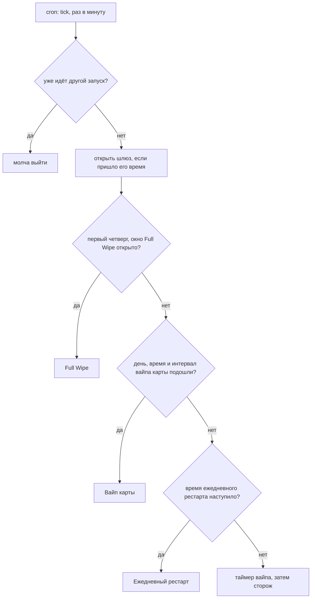
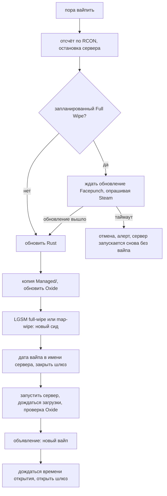
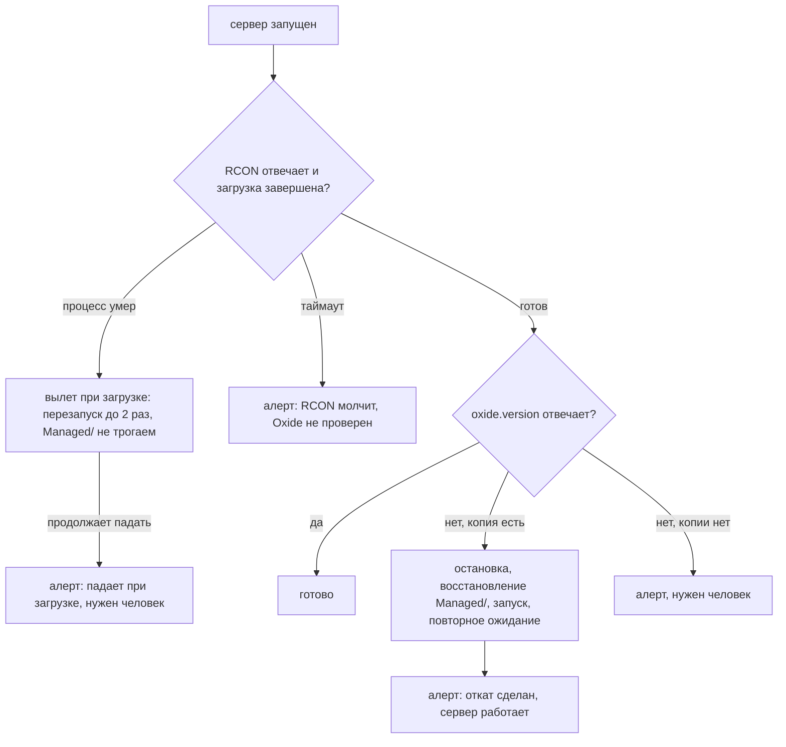
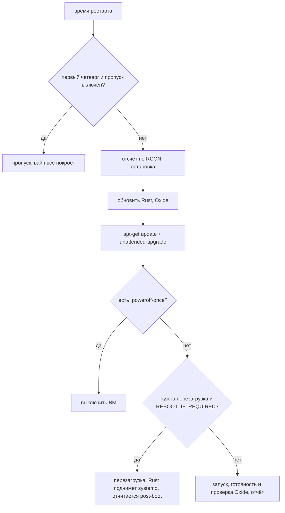
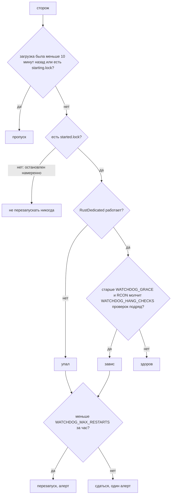

<div align="center">

# Rust Wipe Manager

**Вайпы, рестарты и обновления [Rust](https://rust.facepunch.com/)-сервера на [LinuxGSM](https://linuxgsm.com/) без вашего участия, с отчётами в Telegram.**

[](LICENSE)
[](manager.sh)
[](https://linuxgsm.com/)
[](https://ubuntu.com/)
[](https://github.com/wobujidao/rust-wipe-manager/commits)

[English](README.md) | **Русский**

</div>

Содержать Rust-сервер значит жить по календарю. Каждый день нужны рестарт и обновления. В первый четверг месяца Facepunch выпускает принудительное обновление в 19:00 по Лондону, и к этому моменту сервер должен быть остановлен, вайпнут, обновлён, загружен и вовремя открыт для игроков. На новой сборке может сломаться Oxide. А ещё серверы падают и зависают в три часа ночи.

Rust Wipe Manager берёт всё это на себя и запускается одной строкой в cron. Расписание вы описываете в одном конфиге, скрипт делает работу и сообщает о каждом шаге в Telegram, а встроенный сторож поднимает сервер, если он упал. Это один Bash-скрипт, которому не нужно ничего сверх того, что и так есть на хосте с LinuxGSM. Он написан и работает на боевом сервере (Ubuntu 24.04, виртуалка Proxmox, LinuxGSM, uMod/Oxide).

## Содержание

- [Возможности](#возможности)
- [Быстрый старт](#быстрый-старт)
- [Требования](#требования)
- [Установка](#установка)
- [Справочник по настройкам](#справочник-по-настройкам)
- [Команды](#команды)
- [Как это работает](#как-это-работает)
- [Сообщения в Telegram](#сообщения-в-telegram)
- [Решение проблем](#решение-проблем)
- [Участие в разработке](#участие-в-разработке)
- [Лицензия](#лицензия)

## Возможности

**Расписание**
- Одна строка в cron, `manager.sh tick` раз в минуту, запускает всё расписание из `config.env`. Время и интервалы меняются в конфиге, cron трогать не нужно.
- **Ежедневный рестарт** с отсчётом для игроков через RCON, обновлением Rust и Oxide и обновлением ОС, пока сервер остановлен.
- **Full Wipe** в первый четверг месяца: стартует до выхода обновления Facepunch, дожидается, пока оно действительно появится в Steam, затем вайпает карту и чертежи.
- **Вайпы карты** между принудительными вайпами: в выбранный день недели, раз в N недель, при желании только в заданные числа месяца. Чертежи остаются.
- Каждое событие срабатывает раз в сутки в пределах окна. Если машина в это время была выключена, событие пропускается, а не запускается на несколько часов позже.

**После вайпа**
- **Шлюз открытия**: сервер поднимается с `maxplayers 0`, игроки ждут в штатной очереди Rust, а в нужный момент (точное время или ближайшая отметка в N минут после загрузки) сервер открывается.
- **Имя сервера с датой вайпа** (`My Rust Server | WIPE 06.11`) и **настоящее время следующего вайпа в браузере серверов**.
- Сообщение «новый вайп» уходит, только когда сервер действительно загрузился: RCON отвечает *и* в консольном логе есть `Server startup complete`.

**Страховки**
- **Проверка Oxide** после каждого запуска с откатом `Managed/` на копию, сделанную перед обновлением Oxide. Вылет игры во время загрузки перезапускается и не принимается за поломку Oxide.
- **Сторож (watchdog)**: перезапускает упавший или зависший сервер, сдаётся после слишком частых перезапусков за час и не трогает сервер, который вы остановили сами.
- **Обслуживание ОС** в окне рестарта: `unattended-upgrade`, перезагрузка, если её просит система, отчёт после загрузки и одноразовый флаг выключения для работ на стороне хоста.
- Один запуск за раз (`flock`), секреты отдельно от конфига.

**Telegram**
- Три уровня подробности, сообщения на русском или английском, обычный текст, в котором `+` и `_` доходят без искажений.

## Быстрый старт

Для хоста, на котором уже работает Rust-сервер на LinuxGSM под управлением systemd (если ещё нет, смотрите [Установку](#установка)):

```bash
git clone https://github.com/wobujidao/rust-wipe-manager.git ~/rust_server
cd ~/rust_server && mkdir -p logs
cp config.env.example config.env
cp secrets.env.example .secrets.env && chmod 600 .secrets.env
nano config.env .secrets.env        # пути, имя сервера, расписание, токен бота, пароль RCON

./manager.sh test-telegram          # должно прийти сообщение
./manager.sh check-update           # выведет "UPDATE AVAILABLE" или "No update" (код 2: сборки не прочитаны)

crontab -e                          # добавьте две строки ниже
```

```cron
* * * * * /home/YOUR_USERNAME/rust_server/manager.sh tick >> /home/YOUR_USERNAME/rust_server/logs/cron.log 2>&1
@reboot   /home/YOUR_USERNAME/rust_server/manager.sh post-boot >> /home/YOUR_USERNAME/rust_server/logs/cron.log 2>&1
```

Готово: теперь расписание живёт в `config.env`. Вайпы карты и шлюз открытия по умолчанию выключены, см. [Справочник по настройкам](#справочник-по-настройкам).

## Требования

- Linux с **systemd** и **cron**. Разрабатывалось и работает на Ubuntu 24.04 LTS, дистрибутивы на базе Debian должны подойти.
- Рабочий **LinuxGSM** `rustserver` с установленным **Oxide/uMod**: скрипт управляет сервером командами LGSM.
- [**rcon-cli**](https://github.com/gorcon/rcon-cli) от gorcon (скрипт использует WebRCON, который LGSM включает по умолчанию).
- Обычные утилиты: `bash`, `curl`, `flock`, `pgrep`, `awk`, `sed`, GNU `date`/`find`/`stat`.
- **Telegram-бот** (необязательно, но рекомендуется): создаётся у [@BotFather](https://t.me/BotFather).
- Права `sudo` у пользователя сервера, ограниченные коротким списком команд (шаг 4 ниже).

## Установка

### 1. LinuxGSM, Rust-сервер и Oxide

```bash
curl -Lo linuxgsm.sh https://linuxgsm.sh && chmod +x linuxgsm.sh && bash linuxgsm.sh rustserver
./rustserver auto-install
./rustserver mods-install        # выберите Oxide
```

В `lgsm/config-lgsm/rustserver/rustserver.cfg` оставьте `seed=""` (тогда LGSM выбирает новый случайный сид при каждом вайпе) и строку `maxplayers="N"` (она нужна шлюзу открытия).

### 2. rcon-cli

```bash
cd ~
wget https://github.com/gorcon/rcon-cli/releases/download/v0.10.3/rcon-0.10.3-amd64_linux.tar.gz
tar -xzf rcon-0.10.3-amd64_linux.tar.gz && rm rcon-0.10.3-amd64_linux.tar.gz
```

### 3. Юнит systemd

Скопируйте [`rustserver.service`](rustserver.service) в `/etc/systemd/system/`, замените `YOUR_USERNAME` и выполните:

```bash
sudo systemctl daemon-reload
sudo systemctl enable --now rustserver
```

> **Почему `Type=oneshot`, а не `forking`?** LinuxGSM запускает сервер внутри tmux и отсоединяет его, поэтому при `forking` systemd теряет настоящий процесс. Связка `oneshot` и `RemainAfterExit=yes` с LGSM работает надёжно.

### 4. sudoers

Скрипту нужен `sudo` без пароля ровно для этих команд:

```bash
echo 'YOUR_USERNAME ALL=(root) NOPASSWD: /usr/bin/systemctl start rustserver, /usr/bin/systemctl stop rustserver, /usr/bin/apt-get update -qq, /usr/bin/unattended-upgrade, /usr/sbin/reboot, /usr/sbin/poweroff' | sudo tee /etc/sudoers.d/YOUR_USERNAME-rustserver
sudo chmod 440 /etc/sudoers.d/YOUR_USERNAME-rustserver
sudo visudo -cf /etc/sudoers.d/YOUR_USERNAME-rustserver
```

Если вы используете `SYSTEM_UPDATE_ENABLED`, отключите ещё и собственные обновления Ubuntu в случайное время суток, чтобы обновления ставились только пока сервер остановлен. В `/etc/apt/apt.conf.d/20auto-upgrades`:

```
APT::Periodic::Update-Package-Lists "1";
APT::Periodic::Unattended-Upgrade "0";
```

### 5. Менеджер

```bash
git clone https://github.com/wobujidao/rust-wipe-manager.git ~/rust_server
cd ~/rust_server
mkdir -p logs                     # cron открывает cron.log раньше, чем скрипт успевает создать папку
cp config.env.example config.env
cp secrets.env.example .secrets.env
chmod 600 .secrets.env
```

`config.env`, `.secrets.env`, `logs/` и `.state/` внесены в `.gitignore`, поэтому `git pull` обновляет скрипт и не затрагивает ваши настройки.

### 6. Настройка

- `.secrets.env`: `TELEGRAM_BOT_TOKEN` (от @BotFather), `TELEGRAM_CHAT_ID` (узнать можно у @userinfobot; у групп он отрицательный) и `RCON_PASS` (параметр `rconpassword` в `lgsm/config-lgsm/rustserver/secrets-rustserver.cfg`).
- `config.env`: пути, имя сервера и расписание. Каждая настройка прокомментирована в [`config.env.example`](config.env.example) и перечислена в [справочнике](#справочник-по-настройкам).

### 7. Проверка

```bash
~/rust_server/manager.sh test-telegram    # в Telegram приходит сообщение
~/rust_server/manager.sh check-update     # выводит UPDATE AVAILABLE или No update
```

Вторую команду стоит выполнить и в окружении cron, см. [Решение проблем](#steamcmd-скачивается-заново-или-update-падает-только-из-cron).

### 8. Cron

```bash
crontab -e
```

```cron
* * * * * /home/YOUR_USERNAME/rust_server/manager.sh tick >> /home/YOUR_USERNAME/rust_server/logs/cron.log 2>&1
@reboot   /home/YOUR_USERNAME/rust_server/manager.sh post-boot >> /home/YOUR_USERNAME/rust_server/logs/cron.log 2>&1
```

`tick` каждую минуту читает `config.env` и запускает то, что подошло по времени; если ничего не подошло, запускает сторожа. `post-boot` после любой загрузки ВМ, в том числе после перезагрузок, которые инициирует сам менеджер, сообщает в Telegram, поднялся ли сервер. Все времена указаны по **местному времени ВМ** (`timedatectl`).

### Переход со старых версий

В старых версиях под каждую задачу была своя строка cron (`manager.sh restart` в 04:30 и `manager.sh fullwipe` по четвергам). Удалите их и добавьте строку с `tick`, иначе два запуска стартуют одновременно, и блокировка отменит один из них с алертом в Telegram. Старый `config.env` продолжит работать: настройки, появившиеся позже, получают встроенные значения по умолчанию, а нужные вам можно перенести из `config.env.example`. Если в нём всё ещё `OXIDE_LOAD_TIMEOUT=300`, поднимите значение до `900`, чтобы оно покрывало генерацию карты после вайпа. Команды `restart` и `fullwipe` по-прежнему работают.

## Справочник по настройкам

Настройки лежат в `config.env` (если его или `.secrets.env` нет, скрипт завершится с ошибкой). Булевы значения: `"true"` / `"false"`. Длительности в секундах, если имя не говорит иного. Время в формате `ЧЧ:ММ` по местному времени ВМ.

Столбец **По умолчанию** показывает, что скрипт подразумевает, если строки нет в `config.env`. Крестик (†) отмечает настройки без встроенного значения: строка должна остаться в `config.env`, а указано значение из `config.env.example`.

### Пути и RCON

| Переменная | По умолчанию | Значение |
|---|---|---|
| `LGSM_SCRIPT` | † `/home/YOUR_USERNAME/rustserver` | Скрипт LinuxGSM этого сервера. |
| `LGSM_SELFNAME` | имя файла `LGSM_SCRIPT` | Имя экземпляра LGSM (`rustserver`): по нему названы конфиг, файл сида, консольный лог, lock-файлы и папка identity сервера. Задавайте только при нестандартной раскладке. |
| `LGSM_LOCK_DIR` | `lgsm/lock` рядом с `LGSM_SCRIPT` | Где LGSM хранит `<имя>-started.lock` и `<имя>-starting.lock`. Их читает сторож. |
| `SERVERFILES_DIR` | † `/home/YOUR_USERNAME/serverfiles` | `serverfiles` LGSM (внутри `RustDedicated_Data/`). |
| `RCON_CLI` | † `/home/YOUR_USERNAME/rcon-0.10.3-amd64_linux/rcon` | Путь к бинарнику rcon-cli. |
| `RCON_HOST` | † `127.0.0.1` | Где слушает RCON; скрипт работает на той же машине. |
| `RCON_PORT` | † `28016` | `rconport` из `rustserver.cfg` (по умолчанию порт игры + 1). |

### Секреты (`.secrets.env`, `chmod 600`)

| Переменная | Значение |
|---|---|
| `TELEGRAM_BOT_TOKEN` | Токен бота от @BotFather. |
| `TELEGRAM_CHAT_ID` | Чат или группа, куда идут сообщения. |
| `RCON_PASS` | Пароль RCON (`secrets-rustserver.cfg` в LGSM). |

### Telegram и названия

| Переменная | По умолчанию | Значение |
|---|---|---|
| `ENABLE_TELEGRAM` | † `true` | `false` = только лог-файл. |
| `TELEGRAM_LOG_LEVEL` | † `full` | `full` все шаги; `success_error` итоги и ошибки; `error_only` только ошибки. Неизвестное значение работает как `full`. |
| `MESSAGES_LANG` | `en` | Язык сообщений в Telegram: `en` или `ru`. Лог-файл всегда на английском. |
| `SERVER_NAME` | † `My Rust Server` | Полное имя, используется в крупных сообщениях (рестарт начат, новый вайп). |
| `SERVER_TAG` | † `MYSERVER` | Короткая метка в начале остальных сообщений. |

### Ежедневный рестарт

| Переменная | По умолчанию | Значение |
|---|---|---|
| `DAILY_RESTART_ENABLED` | † `true` | Выполнять ежедневный рестарт (от него зависит и ручная команда `restart`). |
| `DAILY_RESTART_TIME` | `04:30` | Когда начинается отсчёт; сервер останавливается через `DAILY_RESTART_COUNTDOWN`. |
| `DAILY_RESTART_COUNTDOWN` | † `1800` | Отсчёт для игроков. |
| `DAILY_RESTART_UPDATE_RUST` | † `true` | Обновлять Rust (`lgsm update`) на остановленном сервере. |
| `DAILY_RESTART_UPDATE_OXIDE` | † `true` | Обновлять Oxide (`lgsm mods-update`) на остановленном сервере. Вайп всегда обновляет оба. |
| `SKIP_DAILY_RESTART_ON_FULLWIPE_DAY` | † `true` | Пропускать рестарт в первый четверг месяца (вечерний вайп и так перезапускает и обновляет сервер). Действует, только пока `FULLWIPE_ENABLED` равен `true`. |

### Full Wipe

Первый четверг месяца. День не настраивается: в этот день выходит принудительное обновление Facepunch.

| Переменная | По умолчанию | Значение |
|---|---|---|
| `FULLWIPE_ENABLED` | † `true` | Выполнять запланированный Full Wipe (и устаревшую запись `fullwipe`). При `false` ручной `fullwipe-now` не блокируется. |
| `FULLWIPE_LONDON_HOUR` | † `19` | Час (по Лондону), когда выходит обновление Facepunch; в местное время скрипт переводит сам. |
| `FULLWIPE_PRE_WAIT_MINUTES` | † `30` | Отсчёт начинается за столько минут до этого часа, чтобы к выходу обновления сервер уже был остановлен. С этого момента открывается трёхчасовое окно. |
| `FULLWIPE_COUNTDOWN` | † `600` | Отсчёт перед остановкой сервера для **любого** вайпа (и Full Wipe, и вайпа карты). |
| `FULLWIPE_UPDATE_WAIT_MAX` | † `7200` | Сколько запланированный Full Wipe ждёт обновление. По истечении вайп отменяется, приходит алерт, а сервер запускается снова без вайпа. |
| `FULLWIPE_UPDATE_CHECK_INTERVAL` | † `120` | Как часто спрашивать Steam. |
| `FULLWIPE_OPEN_TIME` | `""` | Время открытия после вайпа, см. [Шлюз открытия](#шлюз-открытия). |

### Вайп карты

Только карта, чертежи остаются. По умолчанию выключен.

| Переменная | По умолчанию | Значение |
|---|---|---|
| `MAPWIPE_ENABLED` | `false` | Выполнять вайпы карты. |
| `MAPWIPE_DAY` | `5` | День недели, 1=пн … 7=вс. Не выполняется в день Full Wipe (пока `FULLWIPE_ENABLED` равен `true`). |
| `MAPWIPE_TIME` | `19:00` | Когда начинается отсчёт; сам вайп наступает через `FULLWIPE_COUNTDOWN`. Окно: 1 час. |
| `MAPWIPE_INTERVAL_WEEKS` | `1` | Раз в N недель, считая от **последнего вайпа любого вида** (по возрасту самого свежего файла `*.map`), поэтому принудительный четверговый вайп обнуляет отсчёт. |
| `MAPWIPE_MONTH_DAYS` | `""` | Только в эти числа месяца: `ОТ-ДО` (`16-22`) или одно число; пусто = любые. |
| `MAPWIPE_OPEN_TIME` | `""` | Время открытия после вайпа, см. [Шлюз открытия](#шлюз-открытия). |

```env
# каждую пятницу в 19:00
MAPWIPE_ENABLED="true"  MAPWIPE_DAY=5  MAPWIPE_TIME="19:00"  MAPWIPE_INTERVAL_WEEKS=1

# раз в две недели по понедельникам в 18:00
MAPWIPE_ENABLED="true"  MAPWIPE_DAY=1  MAPWIPE_TIME="18:00"  MAPWIPE_INTERVAL_WEEKS=2

# ровно два вайпа в месяц: принудительный в первый четверг и пятница двумя неделями позже (16-22 числа)
MAPWIPE_ENABLED="true"  MAPWIPE_DAY=5  MAPWIPE_TIME="19:50"  MAPWIPE_MONTH_DAYS="16-22"

# каждый четверг, игроков пускают в 20:00 (первый четверг вместо этого идёт Full Wipe)
MAPWIPE_ENABLED="true"  MAPWIPE_DAY=4  MAPWIPE_TIME="18:45"  MAPWIPE_OPEN_TIME="20:00"
```

Простой двухнедельный интервал в месяцах с пятью неделями добавил бы третий вайп за неделю до принудительного; `MAPWIPE_MONTH_DAYS` этого избегает.

### Витрина сервера

| Переменная | По умолчанию | Значение |
|---|---|---|
| `WIPETIMER_ENABLED` | `false` | Показывать в браузере серверов настоящее время следующего вайпа через `wipetimer.wipeunixtimestampoverride`. Выставляется из `tick`, когда сервер проработал 15 минут, и повторно после каждого запуска. Для Full Wipe показывается время обновления Facepunch; для вайпа карты `MAPWIPE_OPEN_TIME`, а если он пуст или имеет вид `+N`, момент остановки сервера (`MAPWIPE_TIME` + `FULLWIPE_COUNTDOWN`, для `+N` ещё плюс N минут). |
| `SERVERNAME_BASE` | `""` | Базовое имя; вместе со следующей настройкой `servername` в LGSM при каждом вайпе становится `БАЗА \| WIPE дд.мм`. В `rustserver.cfg` должна быть строка `servername="..."`. Символы `"`, `$` и обратная кавычка не допускаются (LGSM исполняет этот файл). |
| `SERVERNAME_WIPE_DATE` | `false` | Включить имя с датой. |

### Oxide и запуск сервера

| Переменная | По умолчанию | Значение |
|---|---|---|
| `OXIDE_BACKUP_BEFORE_UPDATE` | † `true` | Копировать `RustDedicated_Data/Managed` в `Managed.backup-<дата>` перед обновлением Oxide (копии старше 30 дней удаляются). Нужно для отката. |
| `OXIDE_CHECK_ENABLED` | `true` | После запуска проверять `oxide.version`; если Oxide нет, откатывать `Managed/`. Ожидание загрузки сервера выполняется и при `false`. |
| `OXIDE_LOAD_TIMEOUT` | `900` | Сколько ждать полной загрузки сервера после запуска. Должно покрывать генерацию карты после вайпа (на слабом железе больше 10 минут). |
| `SERVER_START_TIMEOUT` | † `600` | Сколько ждать появления процесса `RustDedicated` (используется и в `post-boot`). |

### Обслуживание ОС

| Переменная | По умолчанию | Значение |
|---|---|---|
| `SYSTEM_UPDATE_ENABLED` | `false` (`true` в примере) | Выполнять `apt-get update` и `unattended-upgrade`, пока сервер остановлен. *Что* именно ставится, определяет Ubuntu (`Unattended-Upgrade::Allowed-Origins`). |
| `REBOOT_IF_REQUIRED` | `false` (`true` в примере) | Если есть `/var/run/reboot-required`, перезагрузить ВМ вместо запуска сервера; Rust поднимет systemd. |

Для одноразового выключения настройки нет, нужен флаг: `touch ~/rust_server/.poweroff-once`.

### Сторож

| Переменная | По умолчанию | Значение |
|---|---|---|
| `WATCHDOG_ENABLED` | `true` | Перезапускать упавший или зависший сервер. |
| `WATCHDOG_GRACE` | `1800` | Процесс моложе этого возраста никогда не считается зависшим (генерация карты занимает время). |
| `WATCHDOG_HANG_CHECKS` | `5` | RCON молчит столько проверок подряд (по одной в минуту) = сервер завис. |
| `WATCHDOG_MAX_RESTARTS` | `3` | В час. Сверх этого сторож останавливается и один раз шлёт алерт. |

### Логи

| Переменная | По умолчанию | Значение |
|---|---|---|
| `LOG_DIR` | † `/home/YOUR_USERNAME/rust_server/logs` | Куда пишутся `manager-ГГГГММДД.log` и `cron.log`. |
| `LOG_KEEP_DAYS` | `30` | Удалять `manager-*.log` старше этого срока. `cron.log` при 10 МБ переименовывается в `cron.log.1`. |

## Команды

```bash
./manager.sh <команда>
```

| Команда | Что делает |
|---|---|
| `tick` | Запись для cron (раз в минуту). Открывает шлюз, если его время пришло, затем запускает то, что `config.env` назначает на сейчас (Full Wipe, вайп карты, ежедневный рестарт), а если ничего нет, выставляет таймер вайпа и запускает сторожа. |
| `post-boot` | Запись для `@reboot`. После загрузки ждёт процесс сервера и сообщает результат (с версией ядра). |
| `restart` | Ежедневный рестарт прямо сейчас. Учитывает `DAILY_RESTART_ENABLED` и пропуск в день Full Wipe. |
| `fullwipe-now` | Full Wipe прямо сейчас: без проверки даты и без ожидания обновления Facepunch (обновляется, если сборка вышла, и вайпает в любом случае). Работает даже при `FULLWIPE_ENABLED="false"`. Осторожно. |
| `mapwipe-now` | Вайп карты прямо сейчас: только карта, чертежи остаются, без проверки даты и без ожидания обновления. |
| `watchdog` | Одна проверка сторожа (`tick` и так делает её каждую минуту). |
| `check-update` | Сравнивает локальную и удалённую сборки Rust. Код 0 и `UPDATE AVAILABLE`; 1 и `No update`; 2 и `Cannot read the build numbers (see the log)` (сборки прочитать не удалось). |
| `test-telegram` | Отправляет тестовое сообщение. |
| `fullwipe` | Устаревшая запись для cron, оставшаяся с времён до `tick`: Full Wipe только в первый четверг. |

Одновременно работает только один запуск. Второй ручной запуск отменяется с алертом в Telegram; `tick` и `watchdog` в этом случае молча завершаются.

**Одноразовое выключение** для работ на стороне хоста: `touch ~/rust_server/.poweroff-once`. При ближайшем ежедневном рестарте ВМ выключится вместо запуска сервера. Флаг удаляется при использовании, а включать ВМ обратно должен хост.

Файлы рядом со скриптом:

```
rust_server/
├── manager.sh          скрипт
├── config.env          ваши настройки
├── .secrets.env        токен, chat id, пароль RCON (chmod 600)
├── .manager.lock       flock: один запуск за раз
├── .poweroff-once      необязательный флаг одноразового выключения
├── .state/             метки done-*, gate, hang, restarts, gave_up, wipetimer
└── logs/               manager-ГГГГММДД.log, cron.log (+ cron.log.1)
```

## Как это работает

### Планировщик

`tick` при каждом запуске заново читает `config.env` и выбирает первое, что подошло по времени.



- **Full Wipe**: первый четверг, от `FULLWIPE_LONDON_HOUR` (по Лондону) минус `FULLWIPE_PRE_WAIT_MINUTES`, окно 3 часа. Время переводится в местное с учётом летнего.
- **Вайп карты**: `MAPWIPE_DAY` в `MAPWIPE_TIME`, окно 1 час, если число месяца разрешено `MAPWIPE_MONTH_DAYS`, а последний вайп любого вида достаточно старый. Не в день Full Wipe.
- **Ежедневный рестарт**: `DAILY_RESTART_TIME`, окно 1 час.
- **Раз в сутки**: когда событие стартует, создаётся метка `.state/done-<событие>-<дата>`, поэтому в тот же день оно не повторится. Окна нужны, чтобы выключенная ВМ не запускала событие на несколько часов позже.
- Пока идёт вайп или рестарт, они держат блокировку: `tick` молчит, а сторож не вмешивается.

### Вайп

Одна и та же последовательность обслуживает запланированный Full Wipe, вайпы карты и команды `*-now`.



Обновление Facepunch ждёт только запланированный Full Wipe. Вайпы карты и команды `*-now` выполняют `update` (он ничего не делает, если новой сборки нет) и вайпают в любом случае. Если ожидание закончилось таймаутом или обновление Rust не удалось, вайп отменяется до того, как что-либо стёрто: приходит алерт, а сервер запускается снова как был и проходит проверку Oxide, чтобы игроки не оставались за дверью, пока кто-то отреагирует (второй алерт, «отменён, сервер снова запущен без вайпа», подтверждает это). Вайп выполните вручную, когда получится.

Сид меняет LinuxGSM, а не менеджер. При `seed=""` его `full-wipe` и `map-wipe` записывают новый случайный сид, который показывает сообщение «новый вайп». Одно принудительное обновление Facepunch стирает карту, но сид оставляет прежним, и рельеф повторяется; сид меняет только вайп LGSM. LGSM вайпает, лишь если есть файл `.map`/`.sav`, иначе пишет «Wipe not required».

### Шлюз открытия

Игроки, зашедшие в первую секунду вайпа, перегружают не до конца загруженный сервер. Если задан `MAPWIPE_OPEN_TIME` / `FULLWIPE_OPEN_TIME`, менеджер запускает новую карту с `maxplayers 0` в конфиге LGSM, и все ожидают во встроенной очереди Rust («position N»). В момент открытия прежнее значение возвращается в конфиг и по RCON (`server.maxplayers`, результат перечитывается для проверки), и очередь заходит в порядке прихода.

- `"ЧЧ:ММ"` открывает в точное время сегодня. Запускайте вайп с запасом на генерацию карты (около 12 минут для размера 3500). Если к концу вайпа это время уже прошло, сервер просто открывается, как только поднимется.
- `"+N"` открывает на ближайшей отметке в N минут после того, как сервер *загрузился* (`+5`: поднялся в 22:13, открылся в 22:15), чтобы никто не стоял в очереди дольше N минут. Придумано для Full Wipe, чей старт зависит от Facepunch.
- Состояние хранится в `.state/gate` (`<время открытия> <maxplayers>`). Если запуск оборвался, следующий `tick` откроет сервер, когда время придёт, процесс работает и замечено `Server startup complete`. Остановленный или не до конца загруженный сервер никогда не «открывается»: шлюз остаётся закрытым, следующий тик повторит попытку.
- Если в конфиге LGSM нет строки `maxplayers="N"`, шлюз не закрывается (об этом пишет лог).

### Готовность и проверка Oxide

После каждого запуска менеджер ждёт **готовности**: RCON отвечает на `serverinfo` *и* в консольном логе текущего запуска (`log/console/<имя>-console.log`) есть `Server startup complete`. Одного RCON недостаточно: он отвечает, пока мир ещё загружается. Ожидание считается по настенным часам и заканчивается через `OXIDE_LOAD_TIMEOUT`. Запасные варианты, чтобы пропавшая или переформулированная строка не заблокировала работу навсегда: если консольного лога нет или он старше работающего процесса (логирование консоли выключено), решает один RCON; процесс старше `OXIDE_LOAD_TIMEOUT` проходит и без строки (с записью в лог).



- Откат использует копию `Managed.backup-<дата>`, сделанную прямо перед обновлением Oxide **в этом запуске**. Если запуск Oxide не обновлял, откатывать не к чему, и вы получите алерт.
- Если в том же запуске обновлялся и сам Rust, в копии Oxide нет: сервер работает без плагинов, пока uMod не выпустит исправление. Oxide нередко отстаёт от новой сборки Rust на 30-90 минут.
- Вылет игры при загрузке не считается поломкой Oxide (типичная причина: depot застали посреди публикации). Менеджер перезапускает сервер до двух раз и не трогает `Managed/`; откат делается, только когда сервер отвечает по RCON, но Oxide не загружен.
- «Новый вайп» объявляется и шлюз открывается только для сервера, который работает и загрузился. Иначе шлюз остаётся закрытым, его позже откроет `tick`, а сообщения «вайп начался» не будет.

### Ежедневный рестарт и обслуживание ОС



Штатная остановка отправляет по RCON `restart <отсчёт>`, ждёт окончания отсчёта, затем даёт серверу 3 минуты на выход и только после этого выполняет принудительный `systemctl stop`.

### Сторож

Работает из `tick` каждую минуту (либо из собственной записи cron; тогда «проверка» это один запуск cron).



LinuxGSM удаляет `lgsm/lock/<имя>-started.lock` при штатной остановке (`./rustserver stop`, `systemctl stop rustserver`), поэтому сервер, который вы остановили сами, остаётся остановленным. Команда `quit` из консоли или по RCON оставляет lock-файл и считается падением. Когда сервер снова здоров, `.state/gave_up` очищается. Сторож только перезапускает сервер, проверку Oxide он не выполняет.

### Логи и уборка

В `logs/manager-ГГГГММДД.log` пишется каждый шаг на английском; старые файлы удаляются через `LOG_KEEP_DAYS`. `cron.log` ротируется при 10 МБ. LGSM и rcon-cli запускаются с закрытым файловым дескриптором 9, поэтому блокировка умирает вместе с менеджером и не утекает в tmux. Скрипт сначала переходит в собственную папку, потому что `find` внутри LGSM падает, если унаследованный рабочий каталог недоступен.

## Сообщения в Telegram

Сообщения идут обычным текстом, начинаются с `SERVER_TAG` (крупные содержат `SERVER_NAME`) и отправляются на языке `MESSAGES_LANG`. Уровень определяет, что отправляется: `full` шлёт все три группы, `success_error` последние две, `error_only` только последнюю.

**`full`: ход работы**

| Сообщение | Когда |
|---|---|
| Ежедневный рестарт (отсчёт N мин) | рестарт начался |
| Сегодня полный вайп, ежедневный рестарт пропускаю | первый четверг |
| Команда рестарта отправлена · Сервер остановлен · Принудительная остановка · Сервер уже остановлен | остановка |
| Rust обновлён · Oxide обновлён · Обновления системы установлены | каждое обновление |
| Системе нужна перезагрузка · ВМ выключается для обслуживания хоста | перезагрузка или `.poweroff-once` |
| Жду обновление Rust от Facepunch · Обновление Rust вышло (ждал N мин) | Full Wipe |
| Сегодня полный вайп / вайп карты, подготовка через N мин | только устаревшая запись `fullwipe`, запущенная заранее |
| Начинаю вайп · Выполняю вайп · Вайп выполнен | шаги вайпа |
| Сервер готов, игроки ждут в очереди до ЧЧ:ММ | шлюз закрыт |
| Проверка уведомлений Telegram | `test-telegram` |

**`success`: итоги**

| Сообщение | Когда |
|---|---|
| Ежедневный рестарт завершён | сервер загрузился и проверка Oxide пройдена |
| НОВЫЙ ВАЙП! (с сидом) | сервер загрузился после вайпа |
| Сервер открыт, очередь заходит (слотов: N) | шлюз открыт |
| ВМ загрузилась, сервер запущен (ядро) | `post-boot` |
| Сервер перезапущен сторожем | сторож |

**`error`: ошибки, приходят всегда (кроме отключённого Telegram)**

| Сообщение | Смысл |
|---|---|
| Не удалось отправить RCON-команду · Сервер не запустился за N мин | сбой остановки или запуска |
| Ошибка обновления Rust / Oxide / системы | не удался шаг обновления |
| Обновление Rust не вышло за N мин. Вайп отменён | Full Wipe отменён до вайпа |
| Rust не обновился, вайп отменён · Ошибка: вайп не выполнен | вайп прерван |
| Вайп отменён, сервер снова запущен без вайпа | после любой из двух отмен выше: сервер вернулся, карта прежняя |
| Сервер запущен, но RCON не отвечает уже N мин | таймаут готовности, Oxide не проверен |
| Oxide не загрузился, откатываю · Откат сделан, сервер запущен · Откат не помог · копии Managed/ нет | проверка Oxide |
| Сервер упал, перезапускаю · Сервер завис · Сторож не смог запустить сервер | сторож и вылет при загрузке |
| Сервер падает слишком часто, сторож остановился | слишком много перезапусков сторожа за час |
| Сервер падает при загрузке (3 запуска подряд) | попытки перезапуска при загрузке исчерпаны; `Managed/` не тронут |
| ВМ загрузилась, но сервер не запустился | `post-boot` |
| manager.sh уже работает, второй запуск отменён | занята блокировка |

## Решение проблем

Все времена в логах местные по ВМ. Начинайте с `logs/manager-ГГГГММДД.log` и `logs/cron.log`.

### SteamCMD скачивается заново или update падает только из cron

**Симптом:** `./rustserver update` в вашей оболочке работает, а при запуске из cron LinuxGSM скачивает SteamCMD или обновление падает; `check-update` завершается с кодом 2, а в логе `Cannot get versions (Local= Remote=)`.

**Причина:** пакет `steamcmd` в Ubuntu ставится в `/usr/games`. Этот каталог есть в `PATH` вашей рабочей оболочки, но нет в `PATH` у cron (`/usr/bin:/bin`) и у systemd, поэтому LinuxGSM его не находит и во время `update` и `start` пытается скачать SteamCMD сам.

**Решение:** укажите LinuxGSM установленную копию:

```bash
mkdir -p ~/.steam
ln -s ~/.local/share/Steam/steamcmd ~/.steam/steamcmd
```

Другой вариант: первой строкой crontab добавить `PATH=/usr/games:/usr/bin:/bin`.

**Проверка в точно таком окружении, как у cron:**

```bash
env -i HOME=$HOME PATH=/usr/bin:/bin ~/rust_server/manager.sh check-update
```

Должно вывести `UPDATE AVAILABLE` или `No update`, а в логе должны быть настоящие номера сборок, не `Cannot read the build numbers` (код 2). Тот же приём годится для всего, что под cron ведёт себя иначе, чем в терминале.

### Сервер не поднимается после перезагрузки

```bash
sudo systemctl status rustserver
sudo systemctl is-enabled rustserver
journalctl -u rustserver -n 50
```

Юнит должен быть `enabled` и иметь `Type=oneshot`. Сообщение `post-boot` в Telegram скажет, появился ли процесс за `SERVER_START_TIMEOUT`.

### В логе `sudo: a password is required`

Правило sudoers отсутствует или не совпадает. `sudo -n -l` должен показывать `systemctl start/stop rustserver`, `apt-get update -qq`, `unattended-upgrade`, `reboot` и `poweroff`; если не хватает команды для обслуживания ОС, придёт алерт «ошибка обновления системы».

### `find: Failed to restore initial working directory`

`find` внутри LGSM падает, если унаследованный рабочий каталог недоступен; обычно так бывает после `sudo -u YOUR_USERNAME` из чужого домашнего каталога. `manager.sh` уже сам переходит в свою папку. Для ручных команд LGSM используйте `sudo -iu YOUR_USERNAME`.

### Ежедневный рестарт или вайп не сработал

События срабатывают раз в сутки в пределах окна (1 час для рестарта и вайпа карты, 3 часа для Full Wipe); если ВМ в это время была выключена, событие пропускается. Проверьте также, что строка `tick` есть в `crontab -l`, что времена заданы в часовом поясе ВМ (`timedatectl`), а для вайпов карты что `MAPWIPE_INTERVAL_WEEKS` и `MAPWIPE_MONTH_DAYS` разрешают сегодняшний день (в логе будет `Map wipe day, but the last wipe was N days ago ... skipping`). Окно Full Wipe строится на местной дате ВМ, поэтому ВМ далеко к востоку от Лондона, где 19:00 по Лондону приходится уже после местной полуночи, не поддерживается.

### Full Wipe прошёл на старой версии

Запланированный запуск ждёт обновление, так что виновата, скорее всего, команда `fullwipe-now` (она не ждёт) или неверные номера сборок. Посмотрите в логе фазу ожидания, выполните `./manager.sh check-update` и увеличьте `FULLWIPE_UPDATE_WAIT_MAX`, если Facepunch сильно опоздал.

### Вайп отменился, а сервер работает на старой карте

Пришло «Вайп отменён, сервер снова запущен без вайпа». Запланированный вайп не дождался обновления Facepunch за `FULLWIPE_UPDATE_WAIT_MAX` либо `lgsm update` завершился ошибкой. Ничего не стёрто; менеджер заново запустил сервер, чтобы игроки не остались без него. Когда причина устранена, выполните `./manager.sh fullwipe-now` (или `mapwipe-now`) сами.

### После вайпа у игроков 0 слотов

Шлюз открытия ещё закрыт. `cat ~/rust_server/.state/gate` покажет `<время открытия> <maxplayers>`; `tick` откроет его, когда время придёт и сервер загрузится (ищите в логе строки `Gate:`). Чтобы открыть сразу: `echo "0 $(cut -d' ' -f2 ~/rust_server/.state/gate)" > ~/rust_server/.state/gate`, и следующий тик сделает это. Остановленный или ещё загружающийся сервер никогда не открывается.

### Сервер поднялся снова после того, как я его остановил

Сторож считает падением отсутствие процесса при наличии `started.lock`. `./rustserver stop` и `systemctl stop rustserver` этот файл удаляют, а `quit` из консоли или по RCON нет. Останавливайте сервер через LGSM или systemd либо задайте `WATCHDOG_ENABLED="false"`. Если LGSM лежит в другом месте, задайте `LGSM_LOCK_DIR` / `LGSM_SELFNAME`.

### «Сервер падает слишком часто ... сторож остановился»

За час произошло `WATCHDOG_MAX_RESTARTS` перезапусков. Причину ищите в логах сервера; счётчик сбрасывается, когда сервер снова здоров.

### «Сервер падает при загрузке (3 запуска подряд)»

Сама игра падала при каждом запуске, поэтому менеджер не стал ни откатывать `Managed/`, ни бесконечно перезапускать сервер. Смотрите консольный лог сервера в `log/console/`: частая причина depot, застигнутый посреди публикации после обновления Facepunch, и обычный перезапуск через несколько минут нередко помогает.

### «RCON не отвечает ... Oxide не проверен»

Сервер не загрузился за `OXIDE_LOAD_TIMEOUT`. Генерация карты после вайпа на слабом железе занимает больше 10 минут; увеличьте значение.

### Oxide не загружается после обновления

Проверка должна откатить `Managed/` и прислать алерт. Если в том же запуске обновлялся Rust, в копии Oxide нет, и плагины не работают, пока uMod не выпустит сборку под новый Rust (часто 30-90 минут). После этого выполните `~/rustserver mods-update` и перезапустите сервер. Копии лежат в `~/serverfiles/RustDedicated_Data/Managed.backup-ГГГГ-ММ-ДД/`.

### ВМ выключилась после рестарта и не включилась

Так работает флаг `.poweroff-once`; включить ВМ должен хост. Флаг удаляется при использовании.

### «manager.sh уже работает, второй запуск отменён»

Идёт вайп или рестарт, он держит `.manager.lock`. Оборвавшийся запуск ничего не оставляет: блокировка снимается, когда процесс завершается.

### Сообщения в Telegram не приходят

Выполните `./manager.sh test-telegram` и поищите в логе `Telegram send error`. Проверьте токен и chat id в `.secrets.env` (у групп id отрицательный), что бот состоит в чате, `ENABLE_TELEGRAM="true"` и что `TELEGRAM_LOG_LEVEL` не скрывает это сообщение. `curl https://api.telegram.org/bot<TOKEN>/getMe` должен вернуть `"ok":true`.

### Ограничения

Один сервер на машину (скрипт находит его через `pgrep -x RustDedicated`), один `config.env`. Рассчитан на серверы с Oxide/uMod. Время везде местное по ВМ.

## Участие в разработке

Issues и pull request'ы приветствуются. Это боевой инструмент, поэтому, пожалуйста:

- проверяйте изменения на настоящем Rust-сервере с LinuxGSM (или опишите, как проверяли);
- перед отправкой выполняйте `bash -n manager.sh` и `shellcheck manager.sh`;
- держите `config.env.example`, этот README, `README.md` и `CHANGELOG.md` в соответствии с кодом;
- не используйте в примерах реальные имена хостов, IP-адреса, названия серверов, токены и chat id.

## Лицензия

[MIT](LICENSE).

## Благодарности

[LinuxGSM](https://linuxgsm.com/), [gorcon/rcon-cli](https://github.com/gorcon/rcon-cli), [Facepunch Studios](https://facepunch.com/) (Rust) и [uMod/Oxide](https://umod.org/).
